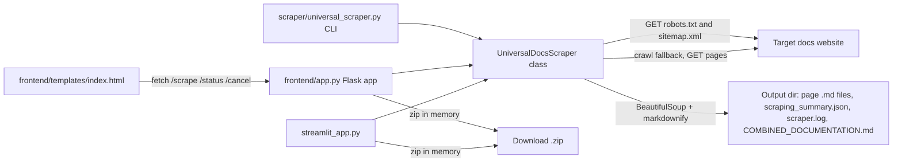
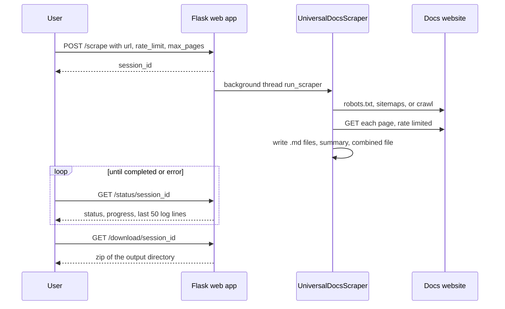

# Universal Documentation Scraper

Turns a documentation website into clean Markdown files, one per page, plus one combined file.
Runs as a Python CLI, a Flask web app, or a Streamlit app.
For people who want docs offline, archived, or ready to feed to an LLM.

## Logs

- [CHANGELOG.md](CHANGELOG.md): release notes per commit
- [PROMPTLOG.md](PROMPTLOG.md): rules and prompts from emino

## Status

| Field | Value |
|---|---|
| Version | v0.1.0 |
| Date | 2026-10-14 |
| Updated by | hermes-agent for emino |
| Default branch HEAD | `2d8487a` (main) |
| Deployment | Configs for Fly.io (`fly.toml`, app `universal-docs-scraper`, region `iad`), Railway (`railway.json`), Render (`render.yaml`) and Docker (`Dockerfile`, port 8080). No live URL is documented in the repo. |

## Architecture



How it works, from `scraper/universal_scraper.py`:

1. URL discovery: reads `Sitemap:` lines from `robots.txt`, then tries `/sitemap.xml`, `/sitemap_index.xml`, `/sitemap-index.xml`, `/sitemaps/sitemap.xml`. Falls back to crawling from the base URL if no sitemap is found.
2. Content extraction: tries platform selectors (Readme.com, GitBook, Docusaurus, MkDocs, Sphinx, then generic `main`, `article`, `#content` and similar). Strips navigation, sidebars and footers via `remove_selectors`.
3. Markdown conversion: `markdownify`, with YAML frontmatter holding `title`, `source_url` and scrape time.
4. Rate limiting: default 1.0 s between requests, `max_pages` default 1000 (CLI) or 100 (web UIs).
5. Summary and combined file: writes `scraping_summary.json` and `COMBINED_DOCUMENTATION.md`.

## User flow



## Components

| Component | Path | Role |
|---|---|---|
| Scraper core and CLI | `scraper/universal_scraper.py` | `UniversalDocsScraper` class: discovery, extraction, Markdown output, summary, combined file. `main()` is the argparse CLI. |
| Flask web app | `frontend/app.py` | HTTP API and UI host. Runs scrapes in background threads, keeps sessions in memory. |
| Web UI | `frontend/templates/index.html` | Single page form. Calls `/scrape`, `/status/<id>`, `/cancel/<id>`. |
| Flask smoke server | `frontend/test_server.py` | Minimal Flask app with one `/` route for deploy checks. |
| Streamlit app | `streamlit_app.py` | Alternative UI: form, live progress, zip download button. |
| Container | `Dockerfile` | python:3.11-slim, installs requirements, runs `python app.py` in `frontend/`, exposes 8080. |
| Deploy configs | `fly.toml`, `railway.json`, `render.yaml`, `deployment.md` | Fly.io, Railway, Render setups and a deploy guide. |
| Example analysis | `analysis/striga_analysis.md` | Analysis of the Striga API docs, made with this scraper. |

## API / Endpoints

### HTTP (Flask, `frontend/app.py`)

No auth on any route. Sessions live in process memory.

| Method | Path | Auth | Purpose |
|---|---|---|---|
| GET | `/` | none | Serves `index.html` |
| POST | `/scrape` | none | JSON body `url` (required), `rate_limit` (default 1.0), `max_pages` (default 100). Starts a background scrape, returns `session_id`. |
| GET | `/status/<session_id>` | none | Status, progress, counts, last 50 log entries, error |
| GET | `/download/<session_id>` | none | Zip of the output dir. 400 if not completed. |
| POST | `/cancel/<session_id>` | none | Marks the session cancelled. The loop stops at the next page. |

`frontend/test_server.py` exposes only `GET /`.

### CLI (`scraper/universal_scraper.py`)

| Argument | Default | Purpose |
|---|---|---|
| `url` (positional) | required | Base URL of the docs site |
| `-o`, `--output` | `scraped_docs` | Output directory |
| `-r`, `--rate-limit` | `1.0` | Seconds between requests |
| `-m`, `--max-pages` | `1000` | Maximum pages to scrape |
| `--urls` | none | Scrape only these URLs, skip discovery |

## Run

```bash
pip install -r requirements.txt

# CLI
python scraper/universal_scraper.py https://docs.example.com
python scraper/universal_scraper.py https://docs.example.com -o my_docs -r 2.0 -m 100
python scraper/universal_scraper.py https://docs.example.com --urls https://docs.example.com/guide https://docs.example.com/api

# Flask web app, then open http://localhost:8080
cd frontend && python app.py

# Streamlit app
streamlit run streamlit_app.py

# Docker
docker build -t universal-docs-scraper .
docker run -p 8080:8080 universal-docs-scraper
```

Env vars read by the code:

| Name | Where | Purpose |
|---|---|---|
| `PORT` | `frontend/app.py` | Flask listen port, default 8080 |

Dependencies (`requirements.txt`): requests, beautifulsoup4, markdownify, lxml, flask, streamlit.

Tests: no test suite in the repo.

## Output structure

The output directory contains:

- One Markdown file per scraped page, with YAML frontmatter (`title`, `source_url`, scrape time) and the page title as H1
- `COMBINED_DOCUMENTATION.md` with all pages in one file
- `scraping_summary.json` with base URL, URL counts, success and failure counts, rate limit, max pages
- `scraper.log` with detailed logs

Scraped output dirs (`scraped_*/`, `striga_docs/`) are gitignored. The scraped Striga docs are not in the repo, only the analysis.

## Configuration

Edit the lists in `scraper/universal_scraper.py`:

```python
self.content_selectors = [
    '.your-custom-selector',
    '#specific-content-id',
]

self.remove_selectors = [
    '.ads',
    '.popup',
]
```

## Example: Striga documentation analysis

`analysis/striga_analysis.md` holds an analysis of the Striga API docs: user stories with auth needs, low-friction Bitcoin to EUR to card paths, endpoint categories, KYC tiers.

## Roadmap

| Item | State |
|---|---|
| Core scraping | done |
| Platform selectors | done |
| Flask and Streamlit UI | done |
| Combined Markdown file | done |
| Auth for private docs | planned |
| PDF export | planned |

## Disclaimer

Respect each site's terms of service and robots.txt. Meant for personal use, archiving and research.

## License

MIT. See [LICENSE](LICENSE).
